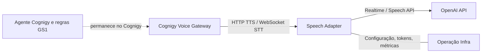

# Briefing para o Comitê de Infraestrutura

## Objetivo

Discutir a hospedagem definitiva do adaptador de Speech da OpenAI para o
Cognigy Voice Gateway, hoje validado em laboratório para o projeto GS1 Brasil.
O pedido ao comitê é definir ambiente, operação, segurança, disponibilidade e
responsáveis antes de homologar tráfego de produção.

## Por que existe um adaptador

O Cognigy Voice Gateway integra fornecedores de fala por contratos próprios de
Custom Speech: TTS via HTTP e STT via WebSocket, com formatos de mensagem,
áudio e autenticação esperados pelo Voice Gateway. As APIs da OpenAI expõem
contratos diferentes. O adaptador traduz entre os dois lados, converte PCM e
WAV, gerencia a conexão de voz e trata falhas do provedor.

O middleware não substitui a agente Cognigy, não contém regras de negócio e não
decide respostas da conversa. A agente Cognigy permanece responsável pelo
raciocínio e pelos dados do atendimento. O adaptador realiza transporte de
fala e transformação técnica do áudio.

## O que foi validado no laboratório

- TTS Cognigy HTTP em `/synthesize/openai` e STT Cognigy WebSocket em
  `/transcribe/openai`.
- Compatibilidade de autenticação Bearer Cognigy; tokens gerados pelo portal
  são armazenados como hash e podem ser revogados.
- Chave OpenAI guardada somente em arquivo no volume do servidor, com acesso
  restrito, sem retorno pela API do painel.
- Configuração de modelos e voz no portal; testes sintéticos TTS/STT.
- Execução em Docker Compose com volume persistente para SQLite e configuração.
- HTTPS externo no laboratório usando o Caddy existente, com proxy para o
  serviço na rede Docker.
- Testes locais automatizados e lint executados no repositório.

Essa validação demonstra funcionamento técnico em laboratório; não equivale a
homologação de segurança, alta disponibilidade, capacidade ou suporte de
produção.

## Estado e fronteiras

- A implantação corrente usa um único container e banco SQLite local em volume.
- O painel administrativo não deve ser publicado para a Internet; acesso deve
  ficar restrito à rede administrativa ou a VPN/SSO/reverse proxy autorizado.
- O serviço precisa de entrada HTTPS para TTS e WebSocket seguro para STT e de
  saída TLS para `api.openai.com`.
- O adaptador atual não é multi-tenant pronto para vários clientes. A separação
  lógica de configurações, chaves, tokens, cotas e auditoria ainda precisa ser
  projetada antes de oferecer serviço compartilhado.
- Voz brasileira dedicada `bossa` está disponível no GPT-Live, mas requer um
  transporte diferente do Realtime atual. A adoção depende de aprovação e teste
  de acesso ao modelo.

## Opções para hospedagem

| Opção | Vantagens | Pontos a decidir |
|---|---|---|
| VM Linux gerenciada pela Infra | Continuidade do padrão de laboratório, controle de rede e rollout simples | Responsabilidade por SO, Docker, backup, monitoramento e failover |
| Plataforma corporativa de containers | Deploy padronizado, health checks, escalabilidade e observabilidade integradas | Compatibilidade com WebSocket persistente, egress, secrets e afinidade/conexões |
| Kubernetes ou plataforma equivalente | Melhor caminho para réplicas, rollout e disponibilidade quando houver escala | Exige operação de plataforma e troca do SQLite por banco apropriado para múltiplas réplicas |

Para uma primeira homologação, a recomendação é uma VM corporativa ou a
plataforma de containers já suportada pela GS1, com uma instância, rede restrita,
monitoramento e backup do volume. A plataforma definitiva deve ser escolhida
pela Infra conforme os padrões existentes. Aumentar réplicas requer primeiro
retirar estado local do SQLite/volume e definir armazenamento compartilhado.

## Controles necessários para produção

1. **Rede:** publicar somente 443 no ingress/reverse proxy; permitir HTTP e
   WebSocket Upgrade; liberar egress TLS para os endpoints OpenAI aprovados;
   restringir o painel administrativo à rede de gestão.
2. **Segredos:** armazenar chave OpenAI, tokens Cognigy e segredo de sessão em
   cofre corporativo; definir responsáveis, rotação e procedimento de revogação.
   No laboratório há suporte a arquivo local protegido; isso precisa ser
   compatibilizado com o padrão corporativo.
3. **Dados e logs:** não registrar áudio, texto integral, CNPJ, Authorization ou
   chaves. Definir retenção de logs, metadados permitidos e tratamento de dados
   pessoais conforme as políticas GS1.
4. **Disponibilidade:** definir SLA, réplicas, health/readiness, reinício,
   manutenção, backup e recuperação. SQLite local é adequado ao piloto de uma
   instância, mas não a múltiplas réplicas simultâneas.
5. **Operação:** dashboards para latência total e primeiro áudio, erros por
   provedor, conexões STT, saturação/concurrency e estado do container; alertas
   sem conteúdo de chamada.
6. **Homologação:** validar chamadas sintéticas e controladas pelo Cognigy,
   codecs, interrupção/hangup, falha/retry do provedor, limite de chamadas,
   latência e qualidade pt-BR. Definir plano de rollback para a configuração
   anterior do Cognigy.
7. **Dependências:** os SDKs Google foram atualizados e as ferramentas de geração
   de protos foram movidas para dependências de desenvolvimento. A auditoria npm
   local reporta zero vulnerabilidades conhecidas neste momento; manter análise
   automatizada de dependências no ciclo de release.

## Decisões solicitadas ao comitê

- Qual plataforma corporativa hospedará o container e quem será o responsável
  operacional?
- Qual URL/DNS, certificado e política de ingress serão usados para HTTP e WSS?
- Qual cofre será usado para as credenciais e quem executará a rotação?
- O painel será acessível apenas por VPN/rede administrativa, ou deverá integrar
  SSO corporativo?
- O piloto será uma instância com SQLite e backup, ou já deve nascer em serviço
  de containers com banco gerenciado?
- Quais metas de disponibilidade, latência, retenção de logs e volume de chamadas
  precisam ser atendidas?
- A Infra autoriza saída de rede do serviço para a OpenAI e quais controles de
  dados/região devem ser aplicados?

## Próximos passos propostos

1. Infra define plataforma, rede, segredo, monitoramento e responsável de
   produção.
2. Projeto atualiza dependências vulneráveis e executa testes de compatibilidade
   antes da imagem candidata.
3. Implantação em ambiente de homologação com chaves de menor privilégio e
   chamadas sintéticas/controladas.
4. Cognigy e negócio validam áudio, STT, latência e contingência; Infra aprova
   critérios operacionais e plano de suporte.
5. Produção ocorre após aceite conjunto e plano de rollback.

## Referências

- [Cognigy Voice Gateway: TTS e STT vendors](https://docs.cognigy.com/voice-gateway/references/tts-and-stt-vendors)
- [Cognigy Custom Speech Developer Guide](https://github.com/Cognigy/custom-speech-example/blob/main/DEVELOPER_GUIDE.md)
- [OpenAI Realtime conversations](https://developers.openai.com/api/docs/guides/realtime-conversations)
- [OpenAI Text to speech](https://developers.openai.com/api/docs/guides/text-to-speech)
- [OpenAI GPT-Live voice options](https://developers.openai.com/api/docs/guides/live-conversations)
- [OpenAI API deprecations](https://developers.openai.com/api/docs/deprecations)

